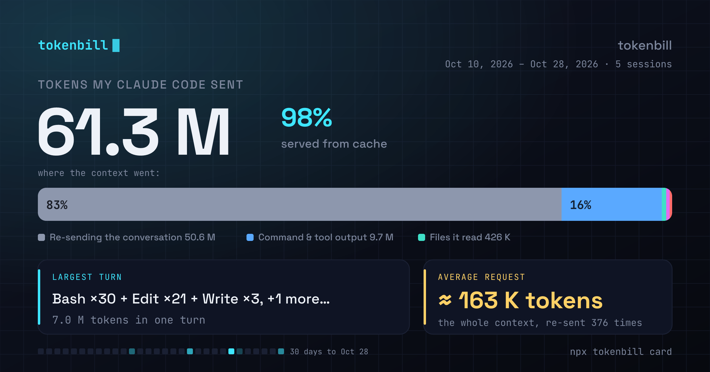

# tokenbill

**Where did my Claude Code context go?**

Every request Claude Code makes re-sends the whole conversation. `tokenbill`
reads the session logs already on your disk and shows what that context was
made of: the conversation itself, command output, files, replies, summaries.
No network calls, no config, no account. Dollars are one flag away (`--cost`)
for API users; subscribers get tokens and their real plan usage.




```
$ npx tokenbill --redact

  tokenbill - tokenbill
  5 sessions · 2026-10-10 → 2026-10-28

  TOKENS SENT AND WRITTEN                           59.4 M tokens

  Where it went
  ──────────────────────────────────────────────────────────────────
  Re-sending the conversation        ████████████████████░░░░  83%   49.1 M
  Command & tool output              ████░░░░░░░░░░░░░░░░░░░░  16%    9.3 M
  Files it read                      ░░░░░░░░░░░░░░░░░░░░░░░░   1%    411 K
  Writing replies & code             ░░░░░░░░░░░░░░░░░░░░░░░░   1%    320 K
  Summarizing long chats             ░░░░░░░░░░░░░░░░░░░░░░░░   0%    246 K
  ──────────────────────────────────────────────────────────────────
```

*(Real output from this repository's own sessions: 83% of the context was the
conversation being sent again, request after request. File reads were 1%.)*

### What the logs say

Before 1.0 tokenbill was going to become a per-turn waste detector. Measured
on 22 real sessions (3,098 requests, 840 M tokens) first, the classic
suspects barely showed up:

| Suspected waste | Measured |
|---|---|
| Large tool output kept in context | 1.1% of all context sent |
| Re-reading an unchanged file range | 1 of 141 reads |
| Re-running a failed command unchanged | 0 of 57 failures |
| **The conversation re-sent with each request** | **83% of all context sent** |

Claude Code already trims big outputs and skips unchanged reads. What fills
the context is session length: the average request carried 271 K tokens.
The lever is starting a fresh session per task, and tokenbill shows how much
each session and turn re-sent so you can see where that habit pays.

## Install & run

```
cd your-project && npx tokenbill   # every Claude Code session of this project, aggregated
npx tokenbill <project-dir>        # same, for any project (source dir or log dir both work)
npx tokenbill <session.jsonl>      # deep-dive report for one specific session
```

Run it from a project directory and you get the whole project: per-session
totals, combined categories, and the largest turns across all sessions. Run it anywhere else and it falls back to your most recent
session. Zero configuration either way.

Options:

```
--cost            API-equivalent dollars instead of tokens
--json            machine-readable output (schemaVersion 3, with a "unit" field)
--since <date>    include sessions starting on or after YYYY-MM-DD (UTC),
                  or a relative duration: 7d (last 7 days) or 2w (last 2 weeks)
--until <date>    include sessions through the end of YYYY-MM-DD (UTC),
                  or the day resolved from 7d or 2w (same as --since)
--html [file]     shareable single-file HTML report (default: tokenbill-report.html)
--md [file]       GitHub Markdown report to stdout or a .md file (PR comments, job summaries)
--top <n>         number of largest turns to show (default 10)
--budget <usd>    exit 2 if the estimated cost exceeds this amount (for CI; implies --cost)
--pricing <file>  override the built-in price table with your own JSON (with --cost)
--redact          hide your prompt text (turns show tool activity instead)
--no-color        disable colored output (NO_COLOR env also respected)
```

### Share card

`tokenbill card` turns the same numbers into one image with the 1200×630
layout X, Reddit and LinkedIn use for link previews. The PNG is rendered at 2×
(2400×1260) so it stays sharp on high-density screens; the SVG is 1200×630.

```
npx tokenbill card                  # this project → tokenbill-card.png
npx tokenbill card --all            # every project
npx tokenbill card --out card.svg   # vector instead of PNG
npx tokenbill card --cost           # dollars, with the estimated room to save
```

The card shows the token total, a single spectrum band of where the context
went, the largest turn, and how big the average request was: the whole
context, re-sent once per request. It also prints a ready-to-paste caption.
The card at the top of this page was made with `tokenbill card --redact` on
this repository.

With `--cost` the card shows API-equivalent dollars instead, and the last
panel becomes the savings estimate the report's recommendations point to
(cache breaks, compactions, heavy file reads). That figure is a heuristic,
not money proven lost; there is no token version of it, because a saving is
a price question.

The card quotes your largest prompt. Add `--redact` to hide it: the card
then leads with its largest finding and the one change that helps
("N compactions cost … → start a fresh session per task"). Rendering happens locally with bundled open-source fonts
(Space Grotesk, JetBrains Mono); no browser is needed. If the PNG renderer
has no prebuilt binary for your platform, the card is written as SVG.

### Plan usage in your Claude Code status line

`tokenbill statusline` reads the JSON Claude Code pipes to status line commands
and prints one line: this session's tokens, today's tokens across the project,
your plan usage, cache hit rate, and a warning after a cache prefix break.

```
tokenbill 10.9 M tokens · today 10.9 M · 5h 41% · week 12% · cache 98%
```

The `5h` and `week` figures are the real 5-hour and weekly limits, taken from
the `rate_limits` field Claude Code sends Pro and Max subscribers. When that
field is missing (API keys, or before the first response) they are left out;
tokenbill never turns token counts into a plan percentage. Use
`tokenbill statusline --cost` for dollars instead of tokens.

Install it globally (`npx` would add its startup time to every refresh), then
point `~/.claude/settings.json` at it:

```
npm i -g tokenbill
```

```json
{ "statusLine": { "type": "command", "command": "tokenbill statusline" } }
```

It only parses session files modified today, writes nothing to disk, and never
fails loudly: on any error it prints `tokenbill -` and exits 0.

### GitHub Action and budget guard

For teams on API keys. `--budget` switches the report to dollars, prints it in
full, then exits `2` if you're over.
Exit codes: `0` ok, `1` error, `2` budget exceeded.

CI runners have no `~/.claude`, so point tokenbill at logs you commit to the
repo or download as an artifact. The bundled action writes the Markdown report
to the job summary and applies the guard:

```yaml
- uses: emrehangorgec/tokenbill@v1.0.0
  with:
    path: .agent-logs          # a Claude Code log dir or a single .jsonl
    budget: 25                 # optional: fail the job above $25
```

Or call the CLI directly:

```yaml
- run: npx tokenbill .agent-logs --md --redact >> "$GITHUB_STEP_SUMMARY"
- run: npx tokenbill .agent-logs --budget 25
```

## Every project at once

```bash
npx tokenbill --all
npx tokenbill --all --html all-projects.html
npx tokenbill --all --json
npx tokenbill --all --budget 100
```

`--all` combines every session under `~/.claude/projects` into one report:
the total, per-session totals, model breakdown, daily trend, and the largest
turns across projects. Subagent logs are included through
their parent session, so they are not counted again as separate sessions, and
the report lists the largest sub-agent runs on their own.
Markdown output and the budget guard work too. The budget applies to the entire
recorded history, not a monthly allowance. You cannot combine `--all` with a
session or project path.

## What it tells you

Filter by session start date, including the specified day at midnight UTC:

```bash
npx tokenbill --since 2026-10-01
npx tokenbill --all --since 2026-10-01 --json
```

`--since` also accepts a relative duration - `<n>d` or `<n>w` - counting back
from today (UTC), inclusive:

```bash
npx tokenbill --since 7d    # today and the previous 6 days
npx tokenbill --since 2w    # today and the previous 13 days
```

Use `--until` to include sessions starting through the end of a UTC day:

```bash
npx tokenbill --since 2026-09-01 --until 2026-09-30  # all of September
npx tokenbill --all --until 2026-09-30 --json
```

`--until` accepts the same date forms as `--since`. For example, `--until 7d`
ends on the UTC day six days before today, including that entire day. An end
date before `--since` is an error; equal dates select one full day.
With `card --plan`, the plan fee ends on `--until` too. If `--since` is omitted,
the default 30-day comparison ends on that day.

This includes each matching session in full, even if it spans multiple days.
Sessions without a recorded start time are excluded when filtering. If no
sessions match, the command exits with code 1 and an explanatory message.

- **Tokens sent and written** - every input token (uncached, cache read, cache write) and output token from the logs, deduplicated per API request.
- **Where it went** - the conversation itself vs. command and tool output vs. file reads vs. replies vs. context compaction, attributed by an incremental-delta heuristic: each request's new tokens are classified by what was appended since the previous one, and the whole context is split by that running composition. Categories always sum exactly to the total.
- **Compaction events** - when your context got summarized mid-session, what that re-sent, and how many tokens of history were dropped.
- **Cache efficiency** - hit rate and mid-session cache rebuilds (the signature of a broken prompt prefix).
- **Largest turns** - the moments that moved the most context, labeled with the prompt you typed and what the agent did in response (`--redact` keeps only the latter).
- **Sub-agents** - in project and `--all` reports, how much of the total ran in sub-agents and which runs were largest, labeled with the task each one was given (`--redact` shows the log id instead).
- **Recommendations** - findings you can act on: cache prefix breaks, file-read-heavy sessions, heavy compaction, low hit rates.
- **Daily trend** - a sparkline and per-day breakdown of the last 14 days (project reports).
- **With `--cost`** - the same report in API-equivalent dollars: per-model prices with effective dates, cache reads at 0.1×, cache writes at their 5-minute (1.25×) or 1-hour (2×) premium, web searches at $10 per 1,000, dollars saved by the cache and wasted on rebuilds, and a "potential savings" estimate.
- **Markdown report** - `--md` renders the same report as GitHub tables for PR comments and job summaries.
- **Shareable HTML report** - `--html` writes the whole report as one self-contained dark-theme HTML file (no external requests, sortable turn table) you can open, screenshot, or send to your team.

## Honest caveats

- Token totals come straight from the logs. The split by category is a documented heuristic, not exact accounting: tool output and file sizes are estimated from characters (images from their pixel size).
- A token is not a unit of your plan. Anthropic doesn't publish how tokens map to subscription limits, so tokenbill shows plan usage only as Claude Code reports it, in the status line.
- `--cost` is an **API-equivalent estimate**. On a Claude subscription you pay a flat fee, so it is not your bill.
- Prices change. The table ships with an `asOf` date (printed in every report footer) and is refreshed with `npm run pricing:sync` - see [CONTRIBUTING.md](CONTRIBUTING.md#updating-pricing). Rates have effective dates, so a session is priced at the rate it was actually billed at - including promotional windows like Sonnet 5's introductory $2/$10. `--pricing` still overrides everything without waiting for a release.
- A model with no published rate is **flagged, not guessed at**: it's priced at fallback Sonnet rates and the report marks it (`~unknown model, sonnet rates`).
- Fast mode (`usage.speed`) is priced at its premium and the batch service tier at its discount. Priority tier is billed as standard - if you use it, the total is understated.
- Server tool pricing assumes the standard published rates. Errored web searches aren't billed by the API and don't appear in the logs as charged requests, so they're not counted here either.

## Privacy

`tokenbill` never makes a network call. It reads local files and prints text,
or writes the report or card file you asked for. Reports quote your prompts to
make expensive turns recognizable; that text stays on your machine unless you
share the output, and `--redact` removes it before you do. The test fixtures in this repo are anonymized (same-length placeholder text; structure, token counts and tool names preserved) via [`scripts/anonymize.ts`](scripts/anonymize.ts).

That holds even for pricing: [`scripts/sync-pricing.ts`](scripts/sync-pricing.ts) is run manually to refresh the table, and its output is committed as source. The published package contains `dist` and the card fonts only, so there is no fetch path at runtime, no cache directory, and nothing to opt out of.

## Supported agents

Claude Code today. The parser is an adapter interface (`src/adapters/`) - Codex/Cursor/Aider adapters are welcome contributions.

## Development

```
npm install
npm test          # vitest: unit + golden-file snapshot tests
npm run build     # tsc → dist/
npm run dev       # tsx src/cli.ts
npm run demo      # regenerate assets/demo.svg from fixtures/basic.jsonl

npm run pricing:sync    # refresh the price table from upstream (the only network call)
npm run pricing:audit   # validate the shipped table offline
```

Type-checking is three projects, and CI runs all three - `tsx` and `vitest` both
transpile without checking, so the scripts and the test suite are only covered by
their own configs:

```
npx tsc --noEmit                          # src/ (the build project)
npx tsc --noEmit -p scripts/tsconfig.json # dev scripts
npx tsc --noEmit -p test/tsconfig.json    # test suite
```

See [CONTRIBUTING.md](CONTRIBUTING.md#updating-pricing) before touching prices -
`src/cost/prices.generated.ts` is generated, and hand-curated facts belong in
`src/cost/pricing.overrides.json`. [CONTRIBUTING.md](CONTRIBUTING.md) also covers
adapter contributions.

Licensed under the [MIT License](LICENSE).
